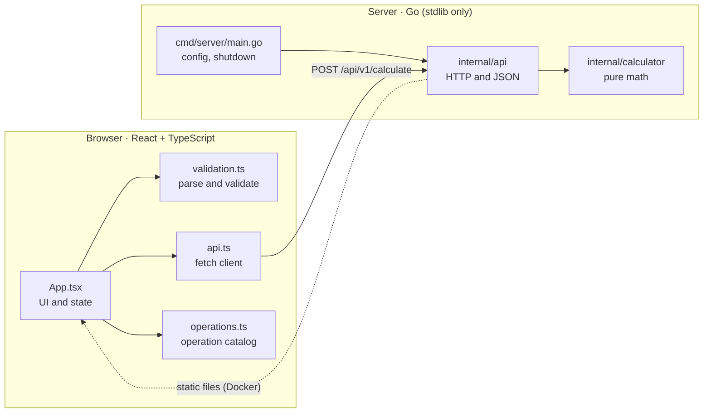
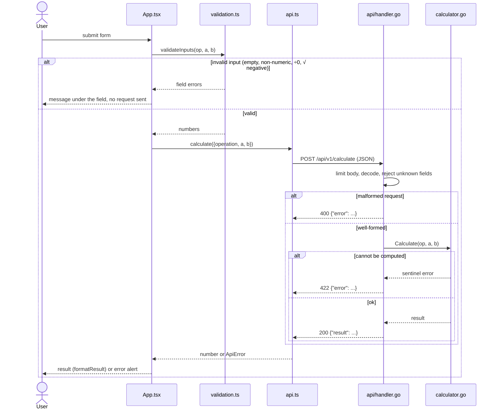
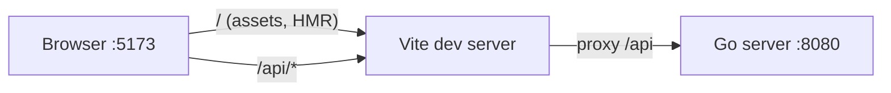
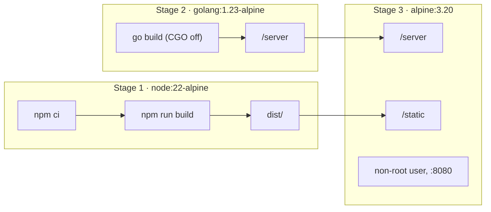

# Architecture and internals

This document goes deeper than the [README](../README.md). The README covers *how to run it* and *how to call the API*; this one explains *how it is built*, *why*, and *how well it is tested*.

- [1. System overview](#1-system-overview)
- [2. Request lifecycle](#2-request-lifecycle)
- [3. Backend](#3-backend)
- [4. Frontend](#4-frontend)
- [5. Shared contract](#5-shared-contract)
- [6. Edge cases: who handles what](#6-edge-cases-who-handles-what)
- [7. Build and deployment](#7-build-and-deployment)
- [8. Testing and coverage](#8-testing-and-coverage)
- [9. Extending the calculator](#9-extending-the-calculator)
- [10. Limitations and future work](#10-limitations-and-future-work)

---

## 1. System overview

Two independently testable pieces communicate over one JSON endpoint. In production a single Go process serves both the API and the compiled React app.



### Guiding principles

| Principle | How it shows up |
|---|---|
| Separation of concerns | Math (`calculator`) knows nothing about HTTP. HTTP (`api`) knows nothing about arithmetic rules. The UI knows nothing about the network beyond `api.ts`. |
| Backend is the authority | The client validates for fast feedback, but the server re-validates everything. |
| Single source of truth | The operation list lives in one place per side (`calculator.go`, `operations.ts`). |
| Minimal dependencies | Go: standard library only. Frontend: React plus the Vite/Vitest toolchain. |
| Testability | Pure functions, dependency injection (`fetch` is a parameter), table-driven tests. |

---

## 2. Request lifecycle

What happens when the user clicks **Calculate** on `2 ÷ 0` versus `2 ÷ 4`:



---

## 3. Backend

### 3.1 Layout

```
backend/
├── go.mod
├── cmd/server/main.go               process wiring
└── internal/
    ├── calculator/
    │   ├── calculator.go            domain logic
    │   └── calculator_test.go
    └── api/
        ├── handler.go               HTTP layer
        └── handler_test.go
```

`internal/` is a Go-enforced boundary: nothing outside this module can import these packages, which keeps the public surface to just the HTTP API.

### 3.2 `internal/calculator`

| Symbol | Purpose |
|---|---|
| `type Operation string` | Typed operation id. Constants: `Add`, `Subtract`, `Multiply`, `Divide`, `Power`, `Sqrt`, `Percentage`. Values match the JSON `operation` field. |
| `func (Operation) IsUnary() bool` | True only for `Sqrt`. Tells `Calculate` that `b` is not required. |
| `Calculate(op, a, b *float64) (float64, error)` | The single entry point. |
| `Err*` sentinels | `ErrDivisionByZero`, `ErrNegativeSqrt`, `ErrUnknownOperation`, `ErrMissingOperand`, `ErrResultNotFinite`, `ErrInvalidOperandNaN`. Compared with `errors.Is`. |
| `isFinite(f)` | Internal guard against `NaN` and `±Inf`. |

**`Calculate` step by step**

1. Reject a non-finite `a`.
2. For binary operations, require `b != nil` and finite. `b` is a pointer so "not sent" is distinguishable from `0`.
3. `switch` on the operation and compute. Division and square root check their own preconditions first.
4. Validate the *result*: anything non-finite is rejected. This single check catches overflow (`1e308 × 10`), `0^-1` and `(-8)^0.5` without special-casing each one.

`Percentage` is defined as *"a percent of b"*, so `Calculate(Percentage, 15, &200)` returns `30`.

### 3.3 `internal/api`

| Symbol | Purpose |
|---|---|
| `CalculateRequest` | `{operation, a *float64, b *float64}`. Pointers detect missing fields. |
| `CalculateResponse` / `ErrorResponse` | `{"result": n}` and `{"error": "..."}`. |
| `NewHandler(staticDir)` | Builds the `http.ServeMux` with method-aware patterns (`POST /api/v1/calculate`, `GET /api/v1/health`). When `staticDir` is non-empty it also serves the built frontend. |
| `calculate` | The handler. Applies the request hardening below, then delegates to `calculator.Calculate`. |
| `describeDecodeError` | Turns `encoding/json` errors into short, stable client messages (empty body, wrong type). |
| `writeJSON` / `writeError` | One place that sets `Content-Type` and status, so every response is consistently JSON. |

**Request hardening in `calculate`**

- `http.MaxBytesReader` caps the body at 1 KiB.
- `DisallowUnknownFields` rejects typos such as `"c": 2`.
- `dec.More()` rejects trailing data after the JSON object.
- Missing `a` is a `400`; missing `b` is left to the domain layer because it depends on the operation.

**Status code policy**

| Situation | Status | Reason |
|---|---|---|
| Body cannot be understood (empty, malformed, wrong types, unknown fields, missing `a`, too large) | `400` | The *request* is wrong. |
| Body is fine but the operation is impossible (÷0, √ of negative, unknown op, missing `b`, non-finite result) | `422` | The request is well-formed but semantically unprocessable. |
| Wrong HTTP method | `405` | Automatic from Go 1.22 method patterns. |

### 3.4 `cmd/server/main.go`

Reads `PORT` (default `8080`) and `STATIC_DIR`, builds an `http.Server` with `ReadHeaderTimeout`, `ReadTimeout` and `WriteTimeout` (protection against slow clients), starts it in a goroutine, and waits for `SIGINT`/`SIGTERM` to call `Shutdown` with a 5 s deadline so in-flight requests finish during `docker stop`.

---

## 4. Frontend

### 4.1 Layout

```
frontend/src/
├── main.tsx           React entry point
├── App.tsx            UI, state, submit flow
├── operations.ts      operation catalog
├── validation.ts      parsing, validation, formatting
├── api.ts             backend client
├── styles.css         theme and responsive layout
├── setupTests.ts      jest-dom matchers
└── *.test.ts(x)       unit and component tests
```

### 4.2 Modules

**`operations.ts`**: `OPERATIONS` is an array of `{id, label, symbol, unary, hintB?}`. The UI renders buttons from it and the form adapts to it (hides the second field when `unary`, relabels it via `hintB`). `getOperation(id)` looks one up.

**`validation.ts`**

| Function | Behavior |
|---|---|
| `parseOperand(raw)` | Trims, then matches a strict regex (`-12`, `3.5`, `.5`, `1e10`). Returns `{value}` or `{error}`. Rejects `""`, `"abc"`, `"1,5"`, `"0x10"`, `"Infinity"` and values that overflow to `Infinity`. `Number()` alone would accept several of those. |
| `validateInputs(op, rawA, rawB)` | Parses both operands (only `a` for unary ops), then adds instant checks: ÷0 and √ of a negative. Returns `{ok: true, a, b?}` or `{ok: false, errors: {a?, b?}}`. |
| `formatResult(n)` | `Number(n.toPrecision(12))` to remove float noise for display only (`0.30000000000000004` → `0.3`). |

**`api.ts`**: `calculate(params, fetchFn = fetch)` posts JSON and returns the numeric result, or throws `ApiError` with a message safe to show. It handles: network failure, non-JSON body (e.g. a proxy's HTML error page), a non-2xx response (uses the server's `error` field when present), and a `200` whose `result` is not a number. `fetchFn` is injectable, which is why the tests need no network or global patching.

**`App.tsx`**

| State | Meaning |
|---|---|
| `opId` | Selected operation. |
| `a`, `b` | Raw text of the two inputs. |
| `fieldErrors` | Per-field validation messages. |
| `serverError` | Message returned by `ApiError`. |
| `result` | Formatted result string. |
| `loading` | Disables the button during the request. |

Flow in `handleSubmit`: clear feedback → `validateInputs` → on failure show field errors and stop → otherwise `calculate` → show `result` or `serverError`. Editing an input or switching operation clears stale feedback so an old result is never shown next to new input.

`Field` is a small presentational component that wires `label`/`htmlFor`, `aria-invalid` and `aria-describedby` to its error message.

### 4.3 Design choices worth knowing

- **Text input with `inputMode="decimal"`**, not `type="number"`. Number inputs return an empty string for partially typed values, behave differently across locales, and make "is this valid?" unreliable. A text field with our own regex gives consistent validation and the numeric keyboard on phones.
- **Accessibility:** real `<label>`s, `aria-invalid`, error text linked via `aria-describedby`, `aria-pressed` on the operation buttons, `role="status"` for the result and `role="alert"` for server errors, and a live region around the output.
- **Responsive:** mobile-first CSS, inputs at 16 px or larger so iOS does not zoom on focus, and a layout that reflows as width grows.
- **Type safety:** `strict` TypeScript with `noUnusedLocals`/`noUnusedParameters`; `OperationId` is a union type so a typo in an operation id fails at compile time.

---

## 5. Shared contract

The two sides agree on this shape. It is the only coupling between them.

```ts
// Request  (frontend/src/api.ts)
{ operation: "add" | "subtract" | "multiply" | "divide" | "power" | "sqrt" | "percentage",
  a: number,
  b?: number }          // omitted for sqrt

// Success  200
{ result: number }

// Failure  400 | 422
{ error: string }
```

```go
// Request  (backend/internal/api/handler.go)
type CalculateRequest struct {
    Operation calculator.Operation `json:"operation"`
    A         *float64             `json:"a"`
    B         *float64             `json:"b,omitempty"`
}
```

Operation ids are duplicated by hand in `calculator.go` and `operations.ts`. That is deliberate at this size (seven ids, both sides tested); at larger scale an OpenAPI spec with generated types would remove the duplication.

---

## 6. Edge cases: who handles what

| Case | Client (instant feedback) | Server (authoritative) |
|---|---|---|
| Empty or non-numeric input | ✅ field message | ✅ `400` on wrong type / missing `a`, `422` on missing `b` |
| Division by zero | ✅ message under `b` | ✅ `422 division by zero` |
| Square root of a negative | ✅ message under `a` | ✅ `422` |
| Overflow (`1e308 × 10`) | ➖ sent to server | ✅ `422 result is not a finite number` |
| `0^-1`, `(-8)^0.5` | ➖ sent to server | ✅ `422 result is not a finite number` |
| Number too large to parse (`1e999`) | ✅ "Number is too large" | ✅ (JSON cannot carry it) |
| Unknown operation | n/a (buttons only) | ✅ `422` |
| Missing / extra / mistyped JSON fields | n/a | ✅ `400` |
| Oversized body | n/a | ✅ `400` |
| Network down | ✅ "Cannot reach the server" | n/a |
| Proxy returns HTML instead of JSON | ✅ "Unexpected server response (status)" | n/a |

Cases marked ➖ are intentionally left to the server: they are rare, and duplicating floating-point overflow logic in JavaScript would add code without adding safety.

---

## 7. Build and deployment

### 7.1 Development topology



The browser only ever talks to one origin (`:5173`), and Vite forwards `/api` to Go, so **no CORS configuration is needed**.

### 7.2 Container build



- Multi-stage build: compilers and `node_modules` never reach the final image.
- `CGO_ENABLED=0` produces a static binary; `-trimpath -ldflags="-s -w"` makes it smaller and reproducible.
- The runtime image runs as an unprivileged user and defines a `HEALTHCHECK` against `/api/v1/health`.
- `STATIC_DIR=/static` tells the Go process to serve the React build, so there is one process, one port and no reverse proxy.

### 7.3 Configuration

| Variable | Default | Effect |
|---|---|---|
| `PORT` | `8080` | Listening port. |
| `STATIC_DIR` | unset | Serve the built frontend from this directory. |

---

## 8. Testing and coverage

### 8.1 Strategy

| Layer | What is tested | Style |
|---|---|---|
| `calculator` | Every operation, every error path, and `errors.Is` matching. | Table-driven unit tests (pure functions). |
| `api` | Status codes, JSON bodies, `Content-Type`, hardening (unknown fields, trailing data, size limit), method handling, health, static serving. | `httptest` against `NewHandler`, no real network. |
| `validation.ts` | Accepted and rejected inputs, per-field errors, ÷0 and √ rules, rounding. | Parameterised unit tests (`it.each`). |
| `api.ts` | Request shape, success, server errors, network failure, non-JSON, malformed 200. | Unit tests with an injected fake `fetch`. |
| `App.tsx` | End-to-end UI behavior: typing, submitting, errors, unary layout, stale-result clearing. | Component tests with Testing Library and a stubbed global `fetch`. |

Latest run: **49 passing Go tests and subtests** and **43 passing frontend tests**.

### 8.2 Coverage results

Generated on 2026-09-29. The raw output is kept in [`coverage.md`](coverage.md).

**Backend** (`go test ./... -cover`)

| Package | Coverage |
|---|---|
| `internal/calculator` | **100%** |
| `internal/api` | **97.1%** |
| `cmd/server` | 0% (not unit tested, see below) |
| **All statements combined** | **77.9%** |

Per function:

| Function | Coverage |
|---|---|
| `calculator.Calculate`, `IsUnary`, `isFinite` | 100% |
| `api.NewHandler`, `calculate`, `describeDecodeError`, `writeError` | 100% |
| `api.writeJSON` | 75% |
| `main`, `getenv` | 0% |

**Frontend** (`vitest run --coverage`, V8 provider)

| File | Statements | Branches | Functions | Lines | Uncovered |
|---|---|---|---|---|---|
| `App.tsx` | 100 | 96.15 | 100 | 100 | line 43 |
| `api.ts` | 100 | 100 | 100 | 100 | none |
| `operations.ts` | 100 | 100 | 100 | 100 | none |
| `validation.ts` | 100 | 100 | 100 | 100 | none |
| **All files** | **100** | **98.55** | **100** | **100** | |

### 8.3 Reading the numbers honestly

- **Why the backend total is 77.9%.** The combined figure is dragged down by `cmd/server/main.go` (0%), which is process wiring: opening a port, waiting for signals, calling `Shutdown`. Unit-testing it would mostly test the standard library. The two packages that hold behavior are at 100% and 97.1%. The combined number is reported anyway rather than hidden.
- **`writeJSON` at 75%.** The uncovered branch logs when encoding a response fails after headers are sent. It cannot be triggered with a valid `ResponseRecorder`, and the fallback is only a log line.
- **`App.tsx` line 43 (branch coverage 96.15%).** This is the `"Something went wrong."` fallback for an error that is *not* an `ApiError`. `api.calculate` only throws `ApiError`, so the branch is a defensive guard against future changes, not a reachable path today.
- **What coverage does not prove.** These figures show which lines ran, not that assertions are meaningful. The tests assert concrete values, status codes and messages, and the edge-case matrix in section 6 is the checklist they were written against.

### 8.4 Reproducing the report

```bash
# Backend
cd backend
go test ./... -coverprofile=coverage.out
go tool cover -func=coverage.out          # per-function table
go tool cover -html=coverage.out          # browsable HTML

# Frontend
cd frontend
npm run test:coverage                      # text table + HTML in frontend/coverage/
```

---

## 9. Extending the calculator

Example: add **modulo**.

1. **Backend, domain:** add `Modulo Operation = "modulo"` and a `case Modulo:` in `Calculate` (reject `b == 0` with `ErrDivisionByZero`, use `math.Mod`).
2. **Backend, tests:** add rows to the two tables in `calculator_test.go` (happy path, ÷0).
3. **Frontend, catalog:** add `"modulo"` to the `OperationId` union and a row in `OPERATIONS` (`unary: false`). The button, the form fields and the API call all follow automatically.
4. **Frontend, validation (optional):** add the ÷0 instant check for `modulo` in `validateInputs`.
5. **Frontend, tests:** add a case to `validation.test.ts`.

The HTTP handler needs **no changes**, which is the payoff of the single generic endpoint.

---

## 10. Limitations and future work

- **Floating point.** The API returns IEEE-754 doubles, so `0.1 + 0.2` is `0.30000000000000004` on the wire; only the UI display is rounded. Exact decimal math (e.g. a decimal library, or strings for operands) would be the next step for financial-grade use.
- **Duplicated operation ids** between Go and TypeScript. An OpenAPI spec with generated types would remove this.
- **No expression chaining or history.** Each request is one operation on one or two operands.
- **No authentication or rate limiting.** Appropriate for a stateless demo; in production these belong at a gateway.
- **No CI pipeline yet.** A workflow running `go vet`, `go test`, `npm test`, `npm run build` and `docker build` on every push would be the first addition.
- **No browser-level e2e tests.** Component tests cover the UI logic; a small Playwright suite would cover the real browser and real server together.
